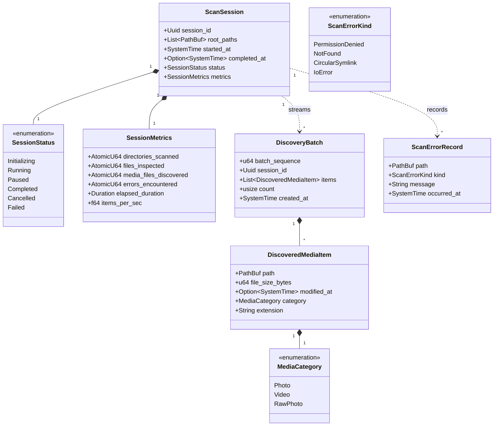
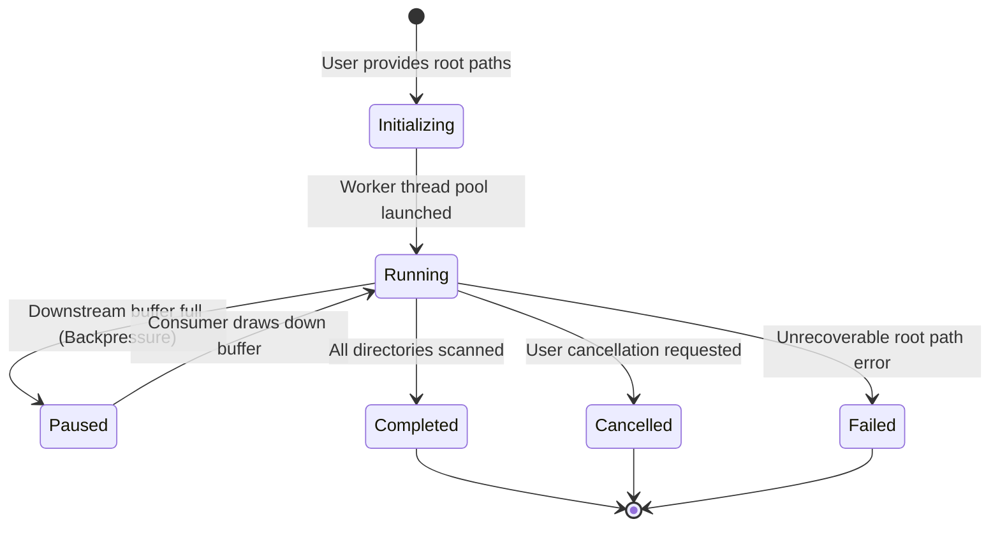

# Data Model: Media Directory Walker

**Feature**: `001-media-directory-walker`  
**Date**: 2026-11-07  
**Status**: Completed  

---

## 1. Domain Entities & Value Objects

---

## 2. Entity Specifications

### 2.1 `DiscoveredMediaItem` (Value Object)
Represents a concrete media asset identified on disk, stripped of external system dependencies.

| Field | Type | Required | Description | Validation Rules |
|---|---|---|---|---|
| `path` | `PathBuf` | Yes | Canonical path to the media file on disk | Must exist at discovery time |
| `file_size_bytes` | `u64` | Yes | File size reported by filesystem metadata | $\ge 0$; 0-byte files flagged |
| `modified_at` | `Option<SystemTime>` | No | Last modification timestamp from OS metadata | Preserved if available |
| `category` | `MediaCategory` | Yes | Classification of media format | One of `Photo`, `Video`, `RawPhoto` |
| `extension` | `String` | Yes | Normalized lowercase file extension (e.g. `jpg`, `cr3`) | Non-empty alphanumeric string |

### 2.2 `MediaCategory` (Enumeration)
- `Photo`: Standard compressed images (`jpg`, `jpeg`, `png`, `webp`, `gif`, `bmp`, `heic`, `avif`).
- `Video`: Video containers (`mp4`, `mov`, `mkv`, `avi`, `webm`, `m4v`, `3gp`).
- `RawPhoto`: Camera RAW sensor formats (`cr2`, `cr3`, `nef`, `arw`, `dng`, `orf`, `rw2`, `pef`).

### 2.3 `DiscoveryBatch` (Entity)
Represents a bounded chunk of discovered items transmitted through asynchronous channels.

| Field | Type | Description |
|---|---|---|
| `batch_sequence` | `u64` | Monotonically increasing sequence number starting at 1 |
| `session_id` | `Uuid` | UUID of the parent `ScanSession` |
| `items` | `Vec<DiscoveredMediaItem>` | Collection of items; length bounded by `batch_size` |
| `count` | `usize` | Number of items in this batch |
| `created_at` | `SystemTime` | Timestamp when the batch was sealed and dispatched |

### 2.4 `ScanSession` (Aggregate Root)
Orchestrates an active directory traversal lifecycle.

| Field | Type | Description |
|---|---|---|
| `session_id` | `Uuid` | Unique identifier for the crawl session |
| `root_paths` | `Vec<PathBuf>` | List of root directories to traverse |
| `started_at` | `SystemTime` | Instant when the session started |
| `completed_at` | `Option<SystemTime>` | Instant when traversal finished or halted |
| `status` | `SessionStatus` | Current operational state |
| `metrics` | `SessionMetrics` | Cumulative metrics snapshot |

### 2.5 `ScanErrorRecord` (Value Object)
Captures non-fatal traversal failures for auditing and downstream inspection.

| Field | Type | Description |
|---|---|---|
| `path` | `PathBuf` | Problematic file or directory path |
| `kind` | `ScanErrorKind` | Categorized error reason |
| `message` | `String` | Detailed OS error message |
| `occurred_at` | `SystemTime` | Timestamp when the error was encountered |

---

## 3. State Transitions (`ScanSession`)

---

## 4. Invariants & Guarantees

1. **Memory Ceiling Invariant**: Total in-flight `DiscoveredMediaItem` instances within the channel MUST NOT exceed `batch_size * channel_capacity`. At default settings (`500 items * 100 batches`), in-flight memory is bounded to $\approx 50,000$ items ($\approx 15 \text{ MB}$).
2. **Cycle Safety Invariant**: Inode pairs `(dev, ino)` visited during a session MUST be recorded in a set for symlink targets; any duplicate target MUST be dropped as `ScanErrorKind::CircularSymlink`.
3. **Immutability**: `DiscoveredMediaItem` and `DiscoveryBatch` are immutable once constructed.
