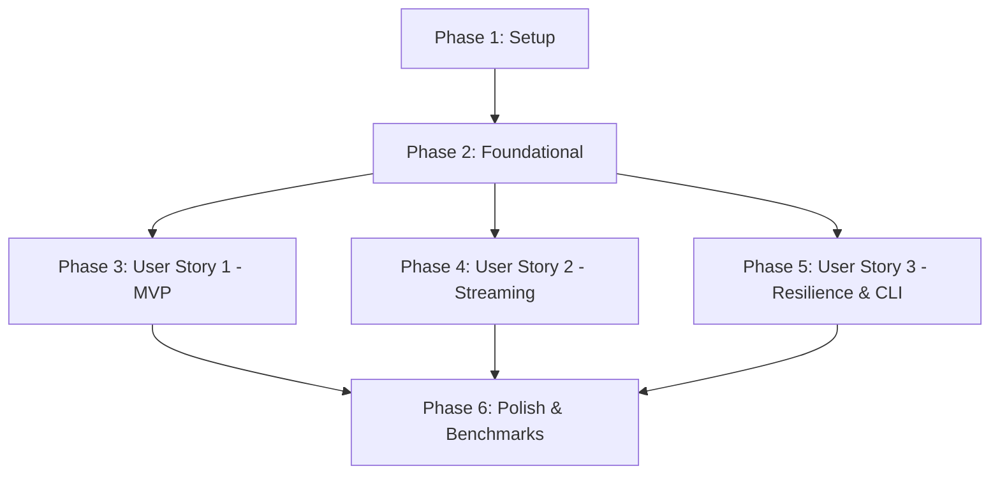

# Implementation Tasks: Media Directory Walker

**Feature**: `001-media-directory-walker`  
**Branch**: `001-media-directory-walker`  
**Date**: 2026-11-07  
**Status**: Completed  
**Specification**: [specs/001-media-directory-walker/spec.md](spec.md)  
**Implementation Plan**: [specs/001-media-directory-walker/plan.md](plan.md)  

---

## Phase 1: Setup (Shared Infrastructure)

**Purpose**: Project initialization, cargo workspace dependencies, and compiler lint configurations.

- [X] T001 Initialize Cargo package and configure dependencies (`tokio`, `jwalk`, `rayon`, `phf`, `tracing`, `metrics`, `thiserror`, `uuid`, `serde`, `serde_json`, `clap`) in Cargo.toml
- [X] T002 Configure compiler flags and strict clippy lint rules (`-D warnings`) in .cargo/config.toml
- [X] T003 [P] Create top-level library module structure and public exports in src/lib.rs

---

## Phase 2: Foundational (Blocking Prerequisites)

**Purpose**: Pure domain models, value objects, error types, and port interfaces. MUST be complete before user story implementations begin.

**⚠️ CRITICAL**: No user story implementation can proceed until all foundational tasks are complete.

- [X] T004 [P] Define domain error types and kinds (`ScanError`, `ScanErrorKind` with variants `PermissionDenied`, `NotFound`, `CircularSymlink`, `IoError`) in src/domain/errors.rs
- [X] T005 [P] Define core media models (`MediaCategory` enum with variants `Photo`, `Video`, `RawPhoto`, and `DiscoveredMediaItem` value object with fields `path: PathBuf`, `file_size_bytes: u64`, `modified_at: Option<SystemTime>`, `category: MediaCategory`, `extension: String`) in src/domain/models.rs
- [X] T006 [P] Define batch and session entities (`DiscoveryBatch` with `batch_sequence: u64`, `session_id: Uuid`, `items: Vec<DiscoveredMediaItem>`, `count: usize`, `created_at: SystemTime`, and `ScanSession` with `SessionStatus`, `SessionMetrics`, and `ScanErrorRecord`) in src/domain/models.rs
- [X] T007 Define domain ports and interface traits (`DirectoryScanner`, `MediaClassifier`, `ScanConfig`, `ScanStream`) in src/domain/ports.rs
- [X] T008 [P] Expose and re-export domain module types in src/domain/mod.rs

**Checkpoint**: Foundation ready — domain layer is pure and testable. User story implementations can now begin.

---

## Phase 3: User Story 1 - Recursive Media Discovery on Target Directories & External Drives (Priority: P1) 🎯 MVP

**Goal**: Recursively traverse directory hierarchies starting from specified root paths—specifically mounted external hard disks (e.g., `/Volumes/SP-1`), SD card backups, or local directories—to discover photo, video, and RAW media files with case-insensitive extension matching, ignoring non-media files.

**Independent Test**: Point scanner at a test fixture folder or external volume mount path containing mixed photo, video, RAW, and non-media files; verify all media assets are accurately identified with canonical paths, byte sizes, and timestamps, while non-media assets are ignored.

### Tests for User Story 1

- [X] T009 [P] [US1] Create test fixture folder with synthetic image, video, RAW, mixed-case, and non-media files in tests/fixtures/media_samples/
- [X] T010 [P] [US1] Implement unit tests for media extension classification (case insensitivity, categories) in tests/unit/classifier_tests.rs
- [X] T014 [US1] Implement integration test verifying recursive media discovery across nested directory hierarchies in tests/integration/traversal_tests.rs

### Implementation for User Story 1

- [X] T011 [P] [US1] Implement compile-time perfect hash set (`phf`) media extension classifier adhering to `MediaClassifier` in src/infrastructure/classifier.rs
- [X] T012 [US1] Implement parallel directory traversal adapter utilizing `jwalk` and `rayon` with hidden folder filtering in src/infrastructure/walker.rs
- [X] T013 [US1] Implement core media discovery use case in src/application/engine.rs integrating `walker` and `classifier` to produce discovered items

**Checkpoint**: User Story 1 is fully functional and delivers an independently testable MVP for file discovery.

---

## Phase 4: User Story 2 - Backpressured Batch Streaming (Priority: P2)

**Goal**: Group discovered media items into configurable, bounded batches and stream them over asynchronous channels with flow control, ensuring memory stays strictly bounded (< 100 MB) during multi-million file scans.

**Independent Test**: Stream a scan of 10,000 files into a throttled consumer; verify initial batch is emitted within 2 seconds, and the scanner pauses file reading when the consumer buffer is full.

### Tests for User Story 2

- [X] T015 [P] [US2] Implement unit tests for batch chunking, sequence numbering, and item accumulation thresholds in tests/unit/batching_tests.rs
- [X] T018 [US2] Implement integration test simulating slow/throttled consumers to verify backpressure pause/resume and bounded memory in tests/integration/backpressure_tests.rs

### Implementation for User Story 2

- [X] T016 [US2] Implement asynchronous batch accumulator and channel emitter with backpressure handling in src/application/batch_accumulator.rs
- [X] T017 [US2] Integrate bounded `tokio::sync::mpsc` streaming into src/application/engine.rs so that walker pauses traversal when channel capacity is reached

**Checkpoint**: User Stories 1 and 2 operate together, providing high-throughput discovery with bounded memory streaming.

---

## Phase 5: User Story 3 - Resilient Traversal & Live Telemetry (Priority: P3)

**Goal**: Isolate filesystem access errors (permission denied, missing paths) and circular symlink loops into diagnostic `ScanErrorRecord`s, emit live telemetry heartbeats, and provide a user-facing CLI.

**Independent Test**: Point scanner at a test hierarchy containing restricted-permission folders and circular symlinks; verify clean completion without panics, errors recorded with diagnostic causes, and periodic telemetry emitted.

### Tests for User Story 3

- [X] T023 [US3] Implement integration tests for circular symlink detection and error quarantine in tests/integration/resilience_tests.rs

### Implementation for User Story 3

- [X] T019 [P] [US3] Implement symlink cycle detection tracking `(dev, ino)` inode pairs in src/infrastructure/cycle_detector.rs
- [X] T020 [P] [US3] Implement atomic telemetry metrics tracker and periodic heartbeat emitter in src/infrastructure/telemetry.rs
- [X] T021 [US3] Integrate cycle detection, per-entry error isolation into `ScanErrorRecord` stream, and telemetry reporter into src/application/engine.rs
- [X] T022 [P] [US3] Implement CLI application entry point and NDJSON streaming formatter per contract in src/main.rs

**Checkpoint**: All three user stories are complete, fully resilient, and accessible via library API or CLI.

---

## Phase 6: Polish & Cross-Cutting Concerns

**Purpose**: Performance benchmarking, end-to-end validation, and code hygiene.

- [X] T024 [P] Implement Criterion micro-benchmarks for directory traversal throughput and classifier lookup in benches/scanner_bench.rs
- [X] T025 Run end-to-end quickstart validation scenarios per specs/001-media-directory-walker/quickstart.md
- [X] T026 [P] Verify code formatting and lint compliance with `cargo fmt --check` and `cargo clippy --all-targets -- -D warnings` in Cargo.toml

---

## Dependencies & Execution Order

### Phase Dependencies



- **Phase 1 (Setup)**: Can start immediately without dependencies.
- **Phase 2 (Foundational)**: Depends on Phase 1; BLOCKS all user stories.
- **Phase 3 (User Story 1)**: Depends on Phase 2; provides the MVP foundation.
- **Phase 4 (User Story 2)**: Depends on Phase 2 and integrates with US1 discovery.
- **Phase 5 (User Story 3)**: Depends on Phase 2 and integrates with US1/US2 engine.
- **Phase 6 (Polish)**: Depends on completion of desired user stories.

---

## Parallel Execution Opportunities

### Phase 1 & 2 Parallel Tasks
```bash
# Foundational domain models and errors can be written in parallel:
Task T004: "Define domain error types in src/domain/errors.rs"
Task T005: "Define core media models in src/domain/models.rs"
Task T006: "Define batch and session entities in src/domain/models.rs"
```

### User Story 1 Parallel Tasks
```bash
# Tests and classifier can be developed concurrently:
Task T009: "Create test fixture folder in tests/fixtures/media_samples/"
Task T010: "Implement unit tests in tests/unit/classifier_tests.rs"
Task T011: "Implement phf media extension classifier in src/infrastructure/classifier.rs"
```

### User Story 3 Parallel Tasks
```bash
# Telemetry and cycle detector can be implemented concurrently:
Task T019: "Implement symlink cycle detection in src/infrastructure/cycle_detector.rs"
Task T020: "Implement atomic telemetry metrics tracker in src/infrastructure/telemetry.rs"
Task T022: "Implement CLI application entry point in src/main.rs"
```

---

## Implementation Strategy

### MVP First (User Story 1 Only)
1. Complete Phase 1 (Setup: `T001`–`T003`).
2. Complete Phase 2 (Foundational: `T004`–`T008`).
3. Complete Phase 3 (User Story 1: `T009`–`T014`).
4. **STOP and VALIDATE**: Verify recursive discovery independently on test directories. Deliver/tag MVP.

### Incremental Delivery
1. Add Phase 4 (User Story 2: `T015`–`T018`) → Validate backpressure with throttled consumer.
2. Add Phase 5 (User Story 3: `T019`–`T023`) → Validate circular symlink safety, error quarantine, and CLI NDJSON streaming.
3. Complete Phase 6 (Polish: `T024`–`T026`) → Run Criterion benchmarks and end-to-end quickstart scenarios.
