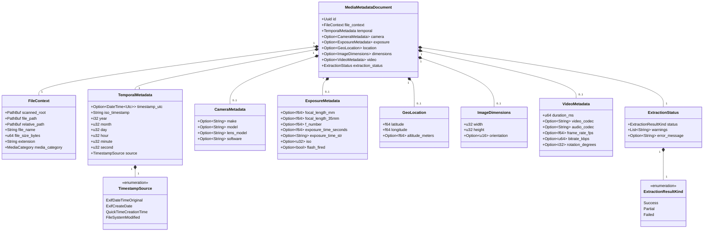

# Data Model: Media Metadata Extraction Engine

**Feature**: `002-extract-media-metadata`  
**Date**: 2026-11-07  
**Status**: Completed  

---

## 1. Domain Entities & Value Objects

---

## 2. Entity Specifications

### 2.1 `MediaMetadataDocument` (Aggregate Root)
The primary normalized document representing an analyzed media file on disk. Designed for direct insertion into document stores like MongoDB.

| Field | Type | Required | Description |
|---|---|---|---|
| `id` | `Uuid` | Yes | Unique identifier for this media document |
| `file_context` | `FileContext` | Yes | Filesystem and directory hierarchy attributes |
| `temporal` | `TemporalMetadata` | Yes | Extracted capture datetime and derived calendar facets |
| `camera` | `Option<CameraMetadata>` | No | Hardware details (make, model, lens, software) |
| `exposure` | `Option<ExposureMetadata>` | No | Optical settings (shutter, aperture, ISO, focal length) |
| `location` | `Option<GeoLocation>` | No | GPS coordinates in decimal degrees |
| `dimensions` | `Option<ImageDimensions>` | No | Pixel width, height, and EXIF orientation |
| `video` | `Option<VideoMetadata>` | No | Video container specifics (duration, codec, fps, rotation) |
| `extraction_status` | `ExtractionStatus` | Yes | Success/partial status and diagnostic warnings |

---

### 2.2 `FileContext` (Value Object)
Captures the spatial context of the file relative to the scan root (e.g. `/Volumes/SP-1`).

| Field | Type | Description | Validation |
|---|---|---|---|
| `scanned_root` | `PathBuf` | The root folder supplied to the scanner (e.g. `/Volumes/SP-1`) | Non-empty path |
| `file_path` | `PathBuf` | Full canonical path on disk | Absolute path |
| `relative_path` | `PathBuf` | Path relative to `scanned_root` | Non-empty relative path |
| `file_name` | `String` | Base file name with extension (e.g. `IMG_1042.CR3`) | Non-empty string |
| `file_size_bytes` | `u64` | Byte size reported by filesystem | $\ge 0$ |
| `extension` | `String` | Normalized lowercase extension | Non-empty string |
| `media_category` | `MediaCategory` | Category (`Photo`, `Video`, `RawPhoto`) | Enum value |

---

### 2.3 `TemporalMetadata` (Value Object)
Decomposes capture timestamps into queryable integer facets optimized for database indexes.

| Field | Type | Description | Example / Range |
|---|---|---|---|
| `timestamp_utc` | `Option<DateTime<Utc>>` | UTC capture instant | `2026-10-14T08:12:45Z` |
| `iso_timestamp` | `String` | ISO 8601 formatted timestamp string | `"2026-10-14T08:12:45Z"` |
| `year` | `i32` | Integer year facet for database partitioning | `2026` |
| `month` | `u32` | Integer month facet | `1..=12` |
| `day` | `u32` | Integer day facet | `1..=31` |
| `hour` | `u32` | Integer hour facet (24h) | `0..=23` |
| `minute` | `u32` | Integer minute facet | `0..=59` |
| `second` | `u32` | Integer second facet | `0..=59` |
| `source` | `TimestampSource` | Origin tag of the timestamp | Enum value |

---

### 2.4 `GeoLocation` (Value Object)
GPS coordinates converted from EXIF rational degrees/minutes/seconds into signed decimal degrees.

| Field | Type | Range | Description |
|---|---|---|---|
| `latitude` | `f64` | `[-90.0, 90.0]` | North (+) or South (-) decimal degrees |
| `longitude` | `f64` | `[-180.0, 180.0]` | East (+) or West (-) decimal degrees |
| `altitude_meters` | `Option<f64>` | Any | Altitude above/below sea level |

---

## 3. Invariants & Data Integrity Rules

1. **Deterministic Calendar Facets**: `year`, `month`, and `day` MUST strictly correspond to `iso_timestamp` in UTC.
2. **Fallback Integrity**: If embedded EXIF or video timestamps are missing, the system MUST compute temporal facets from the file's modification time and set `source = TimestampSource::FileSystemModified`.
3. **Lossless JSON Serialization**: All numeric types MUST serialize to standard JSON numbers (integers or floating-point); non-finite floats (`NaN`, `Infinity`) MUST be serialized as `null`.
4. **Fault Tolerance**: Incomplete, corrupt, or truncated headers MUST produce a `MediaMetadataDocument` with `extraction_status.status = ExtractionResultKind::Partial` or `Failed`, preserving all valid `file_context` attributes.
