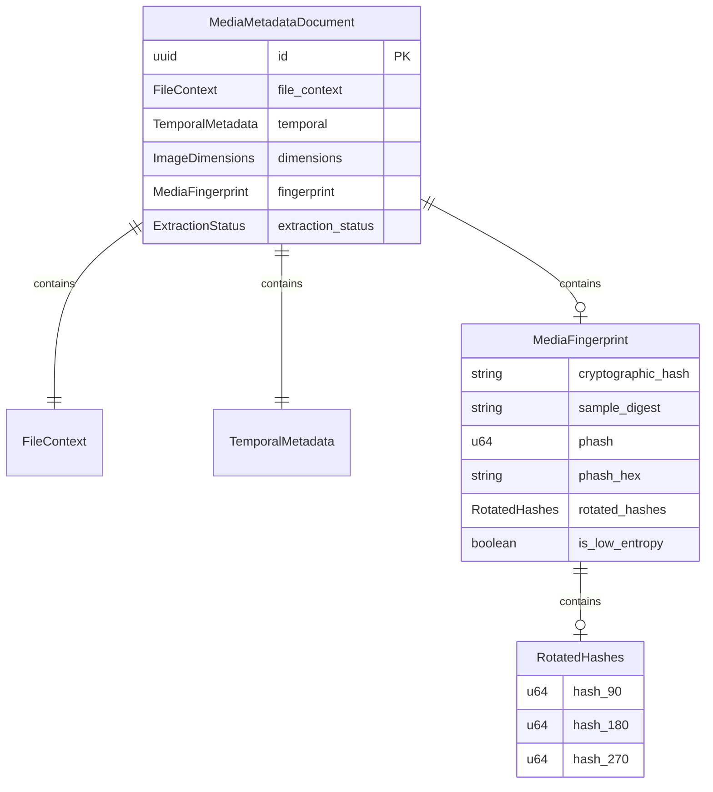

# Data Model: Perceptual Fingerprinting & Hash Extraction

**Feature**: `003-perceptual-deduplication`  
**Date**: 2026-11-07  
**Status**: Revised (Scope Simplified)  

---

## 1. Domain Entities & Value Objects

---

## 2. Entity Definitions

### 2.1 MediaFingerprint / ContentFingerprint
Represents the cryptographic and perceptual visual identity of an individual media file, embedded within `MediaMetadataDocument`.

| Field | Type | Required | Constraints / Validation | Description |
|:---|:---|:---:|:---|:---|
| `cryptographic_hash` | `String` | Yes | 64-character lowercase hex (BLAKE3) | Streaming full-file cryptographic digest |
| `sample_digest` | `Option<String>` | No | 64-character lowercase hex (BLAKE3) | Fast sample digest (first 16 KB + last 16 KB + size) |
| `phash` | `Option<u64>` | No | 64-bit integer | DCT perceptual hash for canonical 0° orientation |
| `phash_hex` | `Option<String>` | No | 16-character lowercase hex | Hex representation of 64-bit DCT perceptual hash |
| `rotated_hashes` | `Option<RotatedHashes>` | No | Three 64-bit integers | Hashes for 90°, 180°, and 270° clockwise orientations |
| `is_low_entropy` | `bool` | Yes | Boolean | True if image is monochromatic, blank, or degenerate ($\sigma^2 < 5.0$) |

### 2.2 RotatedHashes
Value object capturing orientation-variant perceptual hashes for rotation invariance.

| Field | Type | Description |
|:---|:---|:---|
| `hash_90` | `u64` | DCT pHash computed on 90° clockwise rotated raster |
| `hash_180` | `u64` | DCT pHash computed on 180° rotated raster |
| `hash_270` | `u64` | DCT pHash computed on 270° clockwise rotated raster |

---

## 3. Deprecated / Removed Entities (Per User Request)

The following entities from the previous draft are **removed** because cross-file clustering, marking, and duplicate referencing are explicitly out of scope:
- `DuplicateCluster`: Removed.
- `CanonicalAsset`: Removed.
- `DuplicateVariant`: Removed.
- `SimilarityMatch`: Removed.
- `DeduplicationSummary`: Removed.
