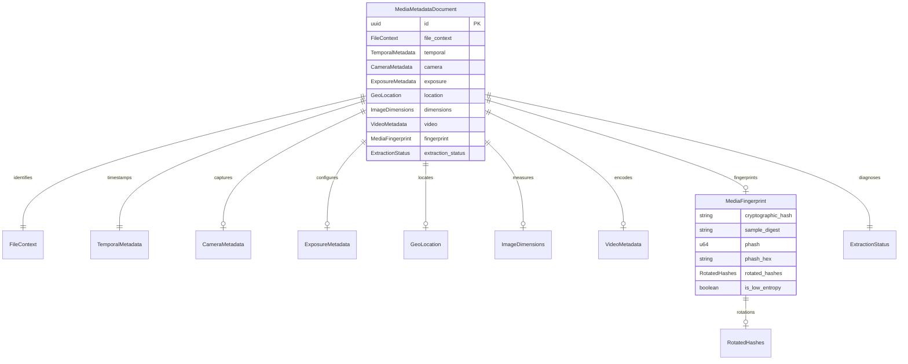

# Data Model: Unified Media Metadata Document

**Feature**: `004-unified-media-scan`  
**Date**: 2026-11-07  
**Status**: Ready for Planning  

---

## 1. Domain Entities & Value Objects

---

## 2. Entity Specifications

### 2.1 MediaMetadataDocument (Root Document)

The unified, self-contained record emitted for every processed media file.

| Field | Type | Required | Description |
|:---|:---|:---:|:---|
| `id` | `Uuid` | Yes | Unique record identifier (UUID v4) |
| `file_context` | `FileContext` | Yes | Filesystem location, relative path, byte size, and media category |
| `temporal` | `TemporalMetadata` | Yes | UTC ISO timestamp and pre-computed calendar facets |
| `camera` | `Option<CameraMetadata>` | No | Camera make, model, lens, and firmware |
| `exposure` | `Option<ExposureMetadata>` | No | Aperture, shutter speed, ISO, focal length |
| `location` | `Option<GeoLocation>` | No | Decimal degree latitude, longitude, and altitude |
| `dimensions` | `Option<ImageDimensions>` | No | Width, height, and display orientation |
| `video` | `Option<VideoMetadata>` | No | Duration, codecs, frame rate, container rotation |
| `fingerprint` | `Option<MediaFingerprint>` | No | BLAKE3 cryptographic hash and 64-bit DCT perceptual hashes |
| `extraction_status` | `ExtractionStatus` | Yes | Success, Partial, or Failed status with diagnostic warnings |

### 2.2 MediaFingerprint

Embedded content fingerprint capturing byte-level and visual identity.

| Field | Type | Required | Description |
|:---|:---|:---:|:---|
| `cryptographic_hash` | `String` | Yes | 64-character lowercase hexadecimal BLAKE3 full-payload digest |
| `sample_digest` | `Option<String>` | No | 64-character hex BLAKE3 digest of header (16 KB) + trailer (16 KB) + file size |
| `phash` | `Option<u64>` | No | 64-bit unsigned integer pure-Rust 2D DCT perceptual visual hash (0° canonical) |
| `phash_hex` | `Option<String>` | No | 16-character hexadecimal string representation of `phash` |
| `rotated_hashes` | `Option<RotatedHashes>` | No | Orthogonal rotation hashes (`hash_90`, `hash_180`, `hash_270`) |
| `is_low_entropy` | `bool` | Yes | Boolean flag (`true` if pixel variance $< 5.0$, indicating blank/monochromatic image) |

### 2.3 FileContext

Filesystem location and classification context relative to the scan root.

| Field | Type | Required | Description |
|:---|:---|:---:|:---|
| `scanned_root` | `PathBuf` | Yes | The root folder passed to the command |
| `file_path` | `PathBuf` | Yes | Canonical filesystem path to the file |
| `relative_path` | `PathBuf` | Yes | Relative path from `scanned_root` |
| `file_name` | `String` | Yes | File name with extension (e.g. `IMG_1042.CR3`) |
| `file_size_bytes` | `u64` | Yes | Total file size in bytes |
| `extension` | `String` | Yes | Lowercase file extension without dot |
| `media_category` | `MediaCategory` | Yes | `Photo`, `Video`, or `RawPhoto` |

### 2.4 TemporalMetadata

Normalized capture timestamp with integer calendar facets for rapid database querying.

| Field | Type | Required | Description |
|:---|:---|:---:|:---|
| `timestamp_utc` | `Option<DateTime<Utc>>` | No | Exact UTC timestamp |
| `iso_timestamp` | `String` | Yes | ISO 8601 / RFC 3339 formatted string |
| `year` | `i32` | Yes | Four-digit calendar year (e.g. 2026) |
| `month` | `u32` | Yes | Calendar month (1-12) |
| `day` | `u32` | Yes | Day of month (1-31) |
| `hour` | `u32` | Yes | Hour of day in UTC (0-23) |
| `minute` | `u32` | Yes | Minute of hour in UTC (0-59) |
| `second` | `u32` | Yes | Second of minute in UTC (0-59) |
| `source` | `TimestampSource` | Yes | Source of date (`ExifDateTimeOriginal`, `QuickTimeCreationTime`, `FileSystemModified`) |
