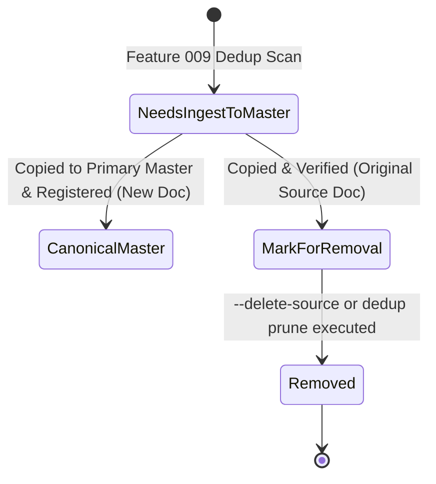

# Data Model: Automated Master Ingestion and Source Deletion Marking

**Feature**: `010-ingest-to-master`  
**Date**: 2026-11-09  
**Status**: Completed  

---

## 1. Domain Entities & Value Objects

```
┌─────────────────────────────────┐
│        MasterIngestPlan         │
│  - source_drive_id: String      │
│  - target_drive_id: String      │
│  - source_mount: PathBuf        │
│  - target_master_root: PathBuf  │
│  - tasks: Vec<IngestTask>       │
│  - total_bytes: u64             │
└───────────────┬─────────────────┘
                │ contains
                ▼
┌─────────────────────────────────┐
│           IngestTask            │
│  - source_doc_id: Uuid          │
│  - source_path: PathBuf         │
│  - target_path: PathBuf         │
│  - category: MediaCategory      │
│  - file_size_bytes: u64         │
│  - cryptographic_hash: String   │
│  - status: IngestTaskStatus     │
└─────────────────────────────────┘
```

### `MasterIngestPlan`
Plan compiled before executing ingestion:
- **`source_drive_id`**: `String` (ID of source drive providing unmastered files)
- **`target_drive_id`**: `String` (ID of primary master drive receiving content)
- **`source_mount`**: `PathBuf` (Mount point of source drive)
- **`target_master_root`**: `PathBuf` (Root path of canonical master hierarchy on target drive)
- **`tasks`**: `Vec<IngestTask>` (List of files to transfer)
- **`total_bytes`**: `u64` (Total bytes across all tasks)
- **`available_target_bytes`**: `u64` (Free disk space on target volume)

### `IngestTask`
Represents an individual file transfer and database registration unit:
- **`source_doc_id`**: `Uuid` (Database document ID of the source record)
- **`source_path`**: `PathBuf` (Current path on secondary drive)
- **`target_path`**: `PathBuf` (Computed canonical destination path on primary master)
- **`category`**: `MediaCategory` (`Photo`, `RawPhoto`, `Video`)
- **`file_size_bytes`**: `u64` (File size in bytes)
- **`cryptographic_hash`**: `Option<String>` (Pre-computed or expected BLAKE3 hash)
- **`status`**: `IngestTaskStatus` (Pending, CopiedVerified, SkippedIdentical, Failed)

### `IngestTaskStatus` (Enum)
- **`Pending`**: Task compiled in plan, not yet transferred.
- **`CopiedVerified`**: Transferred to destination, size and hash verified.
- **`SkippedIdentical`**: An identical file already existed at the canonical destination path; copy skipped.
- **`Failed(String)`**: Transfer or verification error encountered.

### `IngestOptions`
Parameters configuring the ingest execution:
- **`source_drive`**: `String` (Drive ID or mount path)
- **`target_drive`**: `Option<String>` (Optional target drive ID; defaults to highest-priority primary drive)
- **`dry_run`**: `bool` (Preview only without file system or database mutations)
- **`delete_source`**: `bool` (Physically unlink source file after verified ingest)
- **`verify_hash`**: `bool` (Perform full BLAKE3 verification on copied destination file, default: true)

### `IngestExecutionReport`
Output summary returned upon ingest completion:
- **`source_drive_id`**: `String`
- **`target_drive_id`**: `String`
- **`is_dry_run`**: `bool`
- **`total_files_planned`**: `usize`
- **`files_transferred`**: `usize`
- **`files_skipped_identical`**: `usize`
- **`files_failed`**: `usize`
- **`bytes_transferred`**: `u64`
- **`source_files_deleted`**: `usize`
- **`elapsed_seconds`**: `f64`
- **`errors`**: `Vec<String>`

---

## 2. Database State Transitions



### Transition Steps for Asset $A$:
1. **Pre-condition**:
   Source document has `dedup.status = NeedsIngestToMaster`.
2. **Copy & Verification**:
   $A$ is copied from `/Volumes/Drive-3/dump/IMG_0042.JPG` to `/Volumes/SP-1/SPSA/media/master/2021/30-Nov-2021/Photos/IMG_0042.JPG`. Size and BLAKE3 hash verified.
3. **Primary Master Creation**:
   A new MongoDB document with `id = Uuid::new_v4()` is created for the destination path:
   `dedup.status = CanonicalMaster`, `dedup.is_in_master_path = true`, `dedup.reclaimable_bytes = 0`.
4. **Source Document Update**:
   The source MongoDB document is updated:
   `dedup.status = MarkForRemoval`, `dedup.canonical_master_id = Some(new_master_id)`, `dedup.canonical_master_path = Some(new_master_path)`, `dedup.reclaimable_bytes = file_size`.
5. **Optional Source Deletion**:
   If `--delete-source` is supplied:
   The physical file on the source drive is unlinked, and its database status is updated to `dedup.status = Removed`.
