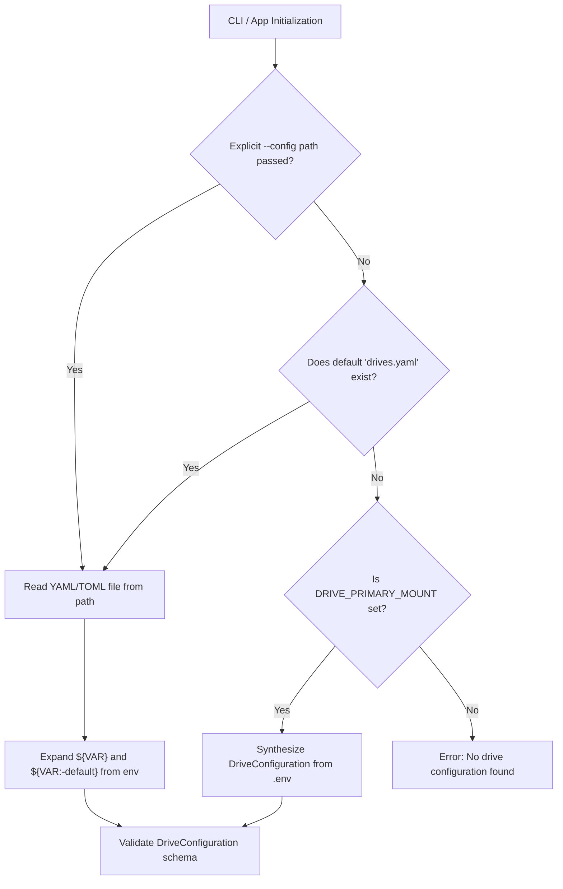

# Data Model: Drive Configuration and Environment Mappings

## 1. Domain Entities

### `DriveConfiguration` (Existing, Reused)
Root configuration object representing all configured drive groups and drive instances.
```rust
pub struct DriveConfiguration {
    pub version: String,
    pub groups: HashMap<String, DriveGroup>,
    pub drives: Vec<DriveDefinition>,
}
```

### `DriveGroup` (Existing, Reused)
Logical tier representing retention precedence.
```rust
pub struct DriveGroup {
    pub priority: u32,
    pub description: Option<String>,
}
```

### `DriveDefinition` (Existing, Reused)
Physical or logical drive representation.
```rust
pub struct DriveDefinition {
    pub id: String,
    pub group: String,
    pub mount_path: PathBuf,
    pub master_path: Option<PathBuf>,
}
```

---

## 2. Environment Variable Resolution Model

### `EnvDriveMapping` (New / Internal)
Represents the mapping rules from environment variables to drive instances:

| Environment Variable | Target Field | Default Behavior / Priority |
|---|---|---|
| `DRIVE_PRIMARY_MOUNT` | `drives[0].mount_path` | Required for env synthesis. Group: `primary`, Priority: `100`, ID: `primary_main` |
| `DRIVE_PRIMARY_MASTER` | `drives[0].master_path` | Defaults to `<DRIVE_PRIMARY_MOUNT>/SPSA/media/master` |
| `DRIVE_PRIMARY_ID` | `drives[0].id` | Defaults to `primary_main` |
| `DRIVE_REPLICA<N>_MOUNT` | `drives[N].mount_path` | Scanned for $N \in [1..=10]$. Group: `replica<N>`, Priority: $80 - (N - 1) \times 10$, ID: `replica_<N>` |
| `DRIVE_REPLICA<N>_MASTER` | `drives[N].master_path` | Defaults to `<DRIVE_REPLICA<N>_MOUNT>/SPSA/media/master` |
| `DRIVE_REPLICA<N>_ID` | `drives[N].id` | Defaults to `replica_<N>` |

---

## 3. Configuration Precedence Matrix


