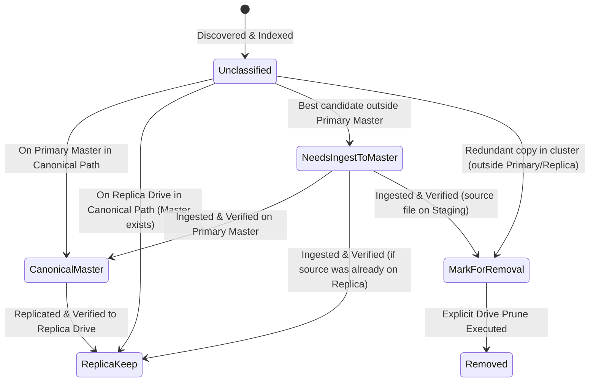

# Phase 1 Data Model: Unified Master Ingestion and Multi-Replica Synchronization

**Feature Branch**: `012-unified-ingest-replication`  
**Date**: 2026-11-10  
**Context**: Entity specifications, validation rules, state transitions, and database schema mappings for universal media classification, master ingestion, and multi-replica synchronization.

---

## 1. Domain Entities & Value Objects

### 1.1 ContentGroup
Represents all media assets in the catalog sharing an identical Tier-3 cryptographic hash (BLAKE3).

```rust
pub struct ContentGroup {
    /// 64-character hexadecimal BLAKE3 cryptographic hash
    pub cryptographic_hash: String,
    /// Collection of catalog records sharing this content hash (len >= 1)
    pub documents: Vec<MediaMetadataDocument>,
}
```

- **Validation Rules**:
  - `cryptographic_hash`: Exactly 64 hexadecimal characters (`^[0-9a-f]{64}$`).
  - `documents`: Must contain at least 1 document (`len() >= 1`).
  - If `documents.len() == 1`, this represents a unique asset.
  - If `documents.len() > 1`, this represents a duplicate asset cluster.

---

### 1.2 AssetLifecycleStatus / DeduplicationStatus
The canonical operational state of a catalog document within the storage hierarchy.

```rust
#[derive(Debug, Clone, Copy, PartialEq, Eq, Hash, Serialize, Deserialize)]
pub enum DeduplicationStatus {
    /// Authoritative master copy located on primary drive in canonical date/category structure
    CanonicalMaster,
    /// Verified backup copy located on a designated replica drive in canonical structure
    ReplicaKeep,
    /// Unmastered asset on secondary/staging drive queued for ingestion to primary master
    NeedsIngestToMaster,
    /// Redundant copy located outside canonical hierarchy or on staging, marked for safe removal
    MarkForRemoval,
    /// Ambiguous situation (e.g. multiple distinct files in primary master with same hash)
    ConflictReview,
    /// File physically removed from disk during pruning
    Removed,
}
```

- **State Transitions**:



---

### 1.3 DeduplicationMetadata (Catalog Embed)
Embedded in `MediaMetadataDocument` in MongoDB under the `dedup` field.

```rust
#[derive(Debug, Clone, PartialEq, Eq, Serialize, Deserialize)]
pub struct DeduplicationMetadata {
    /// Unique identifier for the content cluster (UUID v4)
    pub cluster_id: Uuid,
    /// Current evaluated lifecycle status
    pub status: DeduplicationStatus,
    /// Reference to the authoritative canonical master document ID (UUID v4)
    #[serde(skip_serializing_if = "Option::is_none")]
    pub canonical_master_id: Option<Uuid>,
    /// Absolute filesystem path to the canonical master file
    #[serde(skip_serializing_if = "Option::is_none")]
    pub canonical_master_path: Option<PathBuf>,
    /// ID of the drive hosting this file (e.g., "primary_main", "replica_1", "staging")
    #[serde(skip_serializing_if = "Option::is_none")]
    pub drive_id: Option<String>,
    /// Group classification of the drive ("primary", "replica1", "replica2", "staging")
    #[serde(skip_serializing_if = "Option::is_none")]
    pub drive_group: Option<String>,
    /// Whether file path satisfies `<MasterRoot>/<Year>/<DD-Mon-YYYY>/<Category>/<Filename>`
    pub is_in_master_path: bool,
    /// Bytes reclaimable if this file is deleted (file_size_bytes if MarkForRemoval, else 0)
    pub reclaimable_bytes: u64,
    /// UTC timestamp of evaluation
    pub evaluated_at: DateTime<Utc>,
}
```

---

### 1.4 PathResolution
Result of resolving a target canonical path against existing filesystem contents.

```rust
#[derive(Debug, Clone, PartialEq, Eq)]
pub enum PathResolution {
    /// Destination path does not exist; ready for transfer
    Available(PathBuf),
    /// Destination path exists and matches expected size and BLAKE3 hash; transfer can be safely skipped
    IdenticalExists(PathBuf),
    /// Destination path exists with differing content; collision resolved by appending suffix (`_1`, `_2`)
    CollisionResolved(PathBuf),
}
```

---

### 1.5 ReplicaSyncTask
Represents a single file fanout replication operation from the primary master to a specific replica drive.

```rust
#[derive(Debug, Clone, PartialEq, Eq, Serialize, Deserialize)]
pub struct ReplicaSyncTask {
    /// Task identifier
    pub task_id: Uuid,
    /// Source Canonical Master document ID
    pub canonical_master_id: Uuid,
    /// Absolute path on primary master drive
    pub source_path: PathBuf,
    /// Target destination path on replica drive
    pub target_path: PathBuf,
    /// Destination replica drive identifier
    pub replica_drive_id: String,
    /// Target replica group name (e.g., "replica1", "replica2")
    pub replica_group: String,
    /// Relative path within canonical master root
    pub canonical_rel_path: PathBuf,
    /// Byte size to transfer
    pub file_size_bytes: u64,
    /// Expected BLAKE3 cryptographic hash
    pub cryptographic_hash: Option<String>,
    /// Status of the task
    pub status: IngestTaskStatus,
}
```

---

### 1.6 ReplicaSyncPlan
Pre-execution execution plan detailing all pending file replications across all mounted replica drives.

```rust
#[derive(Debug, Clone, PartialEq, Eq, Serialize, Deserialize)]
pub struct ReplicaSyncPlan {
    /// Source primary master drive ID
    pub primary_drive_id: String,
    /// Source primary master root path
    pub primary_master_root: PathBuf,
    /// List of mounted replica drive IDs included in this plan
    pub active_replica_ids: Vec<String>,
    /// List of configured replica drive IDs that are currently unmounted/offline
    pub offline_replica_ids: Vec<String>,
    /// Planned replication tasks
    pub tasks: Vec<ReplicaSyncTask>,
    /// Total bytes to transfer across all replicas
    pub total_bytes: u64,
}
```

---

### 1.7 ReplicaSyncReport
Comprehensive summary report returned upon completion of replica synchronization.

```rust
#[derive(Debug, Clone, PartialEq, Serialize, Deserialize)]
pub struct ReplicaSyncReport {
    /// Primary master drive ID
    pub primary_drive_id: String,
    /// True if executed as preview dry-run
    pub is_dry_run: bool,
    /// Replicas successfully synchronized
    pub synchronized_replicas: Vec<String>,
    /// Replicas skipped due to being offline
    pub offline_replicas: Vec<String>,
    /// Total tasks planned
    pub total_files_planned: usize,
    /// Files successfully transferred and verified
    pub files_replicated: usize,
    /// Files skipped because destination already possessed identical verified copy
    pub files_skipped_identical: usize,
    /// Files that encountered transfer or verification errors
    pub files_failed: usize,
    /// Total bytes successfully transferred
    pub bytes_transferred: u64,
    /// Total execution duration in seconds
    pub elapsed_seconds: f64,
    /// Error diagnostics if any
    pub errors: Vec<String>,
}
```

---

## 2. Storage Mapping & MongoDB Aggregations

### 2.1 Universal Content Group Query Pipeline
Replaces duplicate-only aggregation by removing the `count > 1` filter:

```json
[
  {
    "$match": {
      "fingerprint.cryptographic_hash": {
        "$ne": null,
        "$exists": true
      }
    }
  },
  {
    "$group": {
      "_id": "$fingerprint.cryptographic_hash",
      "count": { "$sum": 1 },
      "docs": { "$push": "$$ROOT" }
    }
  }
]
```

### 2.2 Replica Presence Verification Query
To identify which `CanonicalMaster` documents are missing on a replica drive $R$:

```json
[
  {
    "$match": {
      "dedup.status": "CanonicalMaster"
    }
  },
  {
    "$lookup": {
      "from": "media_assets",
      "let": { "master_id": "$id", "hash": "$fingerprint.cryptographic_hash" },
      "pipeline": [
        {
          "$match": {
            "$expr": {
              "$and": [
                { "$eq": ["$dedup.drive_id", "<REPLICA_DRIVE_ID>"] },
                { "$eq": ["$dedup.status", "ReplicaKeep"] },
                {
                  "$or": [
                    { "$eq": ["$dedup.canonical_master_id", "$$master_id"] },
                    { "$eq": ["$fingerprint.cryptographic_hash", "$$hash"] }
                  ]
                }
              ]
            }
          }
        }
      ],
      "as": "existing_replica"
    }
  },
  {
    "$match": {
      "existing_replica": { "$size": 0 }
    }
  }
]
```

*(Note: Can also be computed in-memory within the application layer by streaming active canonical masters and querying replica documents, adhering to DDD port abstractions).*
