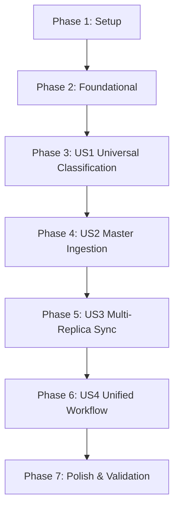

# Tasks: Unified Master Ingestion and Multi-Replica Synchronization

**Input**: Design documents from `/specs/012-unified-ingest-replication/`  
**Prerequisites**: `plan.md`, `spec.md`, `research.md`, `data-model.md`, `contracts/`, `quickstart.md`  

## Format: `[ID] [P?] [Story] Description`

- **[P]**: Can run in parallel (different files, no dependencies)
- **[Story]**: User story label (`[US1]`, `[US2]`, `[US3]`, `[US4]`)
- Exact file paths included in every task description

---

## Phase 1: Setup (Shared Infrastructure)

**Purpose**: Project initialization and basic module wiring

- [X] T001 Register `transfer_service` and `replica_service` module declarations in `src/application/mod.rs` and `src/lib.rs`
- [X] T002 [P] Create initial test scaffold in `tests/test_replica_sync.rs` with mock storage sink supporting replica synchronization verification

---

## Phase 2: Foundational (Blocking Prerequisites)

**Purpose**: Core data models, trait ports, and shared transfer pipeline that MUST be complete before user stories can proceed

**⚠️ CRITICAL**: No user story implementation can begin until this foundational phase is complete.

- [X] T003 [P] Define `PathResolution`, `ReplicaSyncTask`, `ReplicaSyncPlan`, and `ReplicaSyncReport` domain entities in `src/domain/dedup_models.rs`
- [X] T004 [P] Extend `MetadataStorageSink` trait with `query_all_content_groups`, `query_canonical_masters`, and `query_replica_documents` in `src/domain/ports.rs`
- [X] T005 Implement `query_all_content_groups`, `query_canonical_masters`, and `query_replica_documents` in `src/infrastructure/mongodb_sink.rs`
- [X] T006 Implement `UnifiedFileTransferService` in `src/application/transfer_service.rs` with bounded 1MB chunked `stream_copy_verified`, `resolve_collision_path`, and `build_canonical_relative_path`
- [X] T007 [P] Add unit tests for `UnifiedFileTransferService` covering collision resolution, streaming copy, and path formatting in `tests/unit/transfer_service_tests.rs`

**Checkpoint**: Core models, MongoDB aggregation queries, and shared verified transfer service are complete and verified by unit tests.

---

## Phase 3: User Story 1 - Universal Ingest Classification for Unique and Duplicate Media (Priority: P1) 🎯 MVP

**Goal**: Evaluate all media assets—both unique files and duplicate clusters—against primary master and replica hierarchies, classifying assets into `NeedsIngestToMaster`, `CanonicalMaster`, `ReplicaKeep`, or `MarkForRemoval`.

**Independent Test**: Index 5 unique photos and 5 duplicate photos residing on an external staging drive. Run catalog classification. Verify that all 5 unique photos and exactly 1 canonical copy of each duplicate cluster are flagged as `NeedsIngestToMaster`, while redundant duplicate copies are designated as `MarkForRemoval`.

### Tests for User Story 1
- [X] T008 [P] [US1] Add unit and integration tests for universal classification of unique assets and duplicate clusters in `tests/test_database_dedup.rs`

### Implementation for User Story 1
- [X] T009 [US1] Implement `evaluate_content_group` in `src/application/dedup_engine.rs` supporting single unique assets (`len == 1`) and duplicate clusters (`len > 1`), applying group priority ranking when choosing `NeedsIngestToMaster`
- [X] T010 [US1] Implement `run_universal_classification` in `src/application/dedup_engine.rs` using `query_all_content_groups` and batch updates
- [X] T011 [US1] Wire universal classification into the CLI `dedup` command with `--all` flag in `src/main.rs`

**Checkpoint**: User Story 1 is fully functional and testable independently. Unique assets and duplicate clusters are uniformly evaluated and categorized for ingestion.

---

## Phase 4: User Story 2 - Automated Bitwise-Verified Ingestion to Primary Master (Priority: P1)

**Goal**: Transfer assets marked `NeedsIngestToMaster` into the primary master drive's structured date-and-category hierarchy, verify bitwise integrity, register newly written files as `CanonicalMaster`, and mark source copies for removal.

**Independent Test**: Connect a source volume with 10 unmastered media files and a primary master volume. Run master ingestion. Verify that all 10 files are placed in their proper `<Year>/<DD-Mon-YYYY>/{Videos,Photos,PhotosRaw}` folders on the primary master volume with identical byte sizes and BLAKE3 hashes, catalog records reflect `CanonicalMaster`, and source files are flagged for removal.

### Tests for User Story 2
- [X] T012 [P] [US2] Add integration tests in `tests/test_master_ingest.rs` for bitwise verification, collision renaming, and rollback on hash mismatch

### Implementation for User Story 2
- [X] T013 [US2] Refactor `MasterIngestService` in `src/application/ingest_service.rs` to delegate file copy, collision resolution, and hash verification to `UnifiedFileTransferService`
- [X] T014 [US2] Implement replica pre-existing copy transition logic in `src/application/ingest_service.rs` so unique files ingested from a replica drive transition to `ReplicaKeep` rather than `MarkForRemoval`
- [X] T015 [US2] Integrate live progress telemetry and elapsed time reporting into `MasterIngestService` via `IndicatifTerminalProgress`

**Checkpoint**: User Stories 1 and 2 are fully functional. Media assets are reliably classified and transferred into the primary master archive with bitwise integrity guarantees.

---

## Phase 5: User Story 3 - Multi-Replica Synchronization & Fanout (Priority: P1)

**Goal**: Mirror all `CanonicalMaster` assets from the primary master drive to all configured and mounted replica drives (`replica1`, `replica2`, ...), bitwise verify each replica, register verified copies as `ReplicaKeep`, and tolerate unmounted/offline replica drives cleanly.

**Independent Test**: Configure a primary master drive and two replica drives (`replica1`, `replica2`). Run replica synchronization. Verify that files present in the primary master but missing from `replica1` or `replica2` are copied to the respective replica drives at matching relative paths, bitwise verified, and registered as valid replicas (`ReplicaKeep`).

### Tests for User Story 3
- [X] T016 [P] [US3] Add integration tests in `tests/test_replica_sync.rs` for multi-replica fanout, bitwise verification, offline replica tolerance, and `ReplicaKeep` catalog updates

### Implementation for User Story 3
- [X] T017 [US3] Implement `compile_plan` in `src/application/replica_service.rs` identifying missing canonical master assets across all mounted replica drives while tracking offline replica drives
- [X] T018 [US3] Implement `execute_sync` in `src/application/replica_service.rs` executing verified transfers via `UnifiedFileTransferService`, inserting `ReplicaKeep` catalog documents, and emitting progress telemetry
- [X] T019 [US3] Implement CLI subcommand `sync-replicas` (with alias `replicate`) in `src/main.rs` with `--dry-run`, `--replica`, and `--no-verify-hash` flags

**Checkpoint**: Multi-replica synchronization operates independently across N configured replica drives, verifying byte sizes and content hashes and tolerating offline drives.

---

## Phase 6: User Story 4 - Unified Architecture & Redundancy Elimination (Priority: P2)

**Goal**: Unify deduplication, master ingestion, and replica synchronization through a single shared transfer/verification engine and combined command workflows (`ingest --replicate`).

**Independent Test**: Inspect the execution logs and catalog updates during a mixed run containing both duplicate clusters and unique unmastered assets; verify that both asset types pass through the exact same classification rules, transfer pipelines, and verification routines.

### Tests for User Story 4
- [X] T020 [P] [US4] Add integration tests in `tests/test_master_ingest.rs` verifying `--replicate` combined workflow and preview dry-run consistency

### Implementation for User Story 4
- [X] T021 [US4] Add `--replicate` flag to `IngestArgs` in `src/main.rs` and chain `MasterIngestService::execute_ingest` with `ReplicaSyncService::execute_sync`
- [X] T022 [US4] Remove obsolete duplicated file streaming, collision resolution, and path calculation logic from `MasterIngestService` in `src/application/ingest_service.rs` in favor of `UnifiedFileTransferService`

**Checkpoint**: Code duplication between ingest and replication is completely eliminated; single unified command handles ingest-and-replicate end-to-end.

---

## Phase 7: Polish & Cross-Cutting Concerns

**Purpose**: Documentation, formatting, static analysis, and end-to-end validation across all stories

- [X] T023 [P] Update documentation in `README.md` and `apis.md` covering universal classification, master ingest with `--replicate`, and `sync-replicas` CLI commands
- [X] T024 Validate code formatting and clippy lints via `cargo fmt --check` and `cargo clippy --all-targets -- -D warnings`
- [X] T025 Execute quickstart end-to-end validation scenarios per `specs/012-unified-ingest-replication/quickstart.md`

---

## Dependencies & Execution Order

### Phase Dependencies

- **Setup (Phase 1)**: Can start immediately.
- **Foundational (Phase 2)**: Depends on Phase 1; blocks all user stories.
- **User Story 1 (Phase 3)**: Unlocks universal classification for unique assets and duplicate clusters.
- **User Story 2 (Phase 4)**: Depends on US1 classification states (`NeedsIngestToMaster`).
- **User Story 3 (Phase 5)**: Depends on US2 canonical masters residing on the primary drive.
- **User Story 4 (Phase 6)**: Combines US2 and US3 into unified pipeline and CLI workflow.
- **Polish (Phase 7)**: Depends on all user story phases.

---

## Parallel Opportunities

- **Setup & Foundational**:
  - `T002`, `T003`, `T004`, and `T007` can execute in parallel.
- **User Story Tests**:
  - `T008`, `T012`, `T016`, and `T020` can each run in parallel with model/trait tasks across distinct test files.
- **User Stories**:
  - Once Phase 2 completes, `T008` (US1 test) and `T012` (US2 test) can begin in parallel.
- **Polish**:
  - `T023` (documentation) can run in parallel with code validation.

---

## Implementation Strategy (MVP & Incremental Delivery)

1. **MVP Scope (Phase 1 to Phase 3)**:
   - Delivers Universal Ingest Classification (`dedup --all`).
   - Solves the primary user question: automatically detecting unique media assets outside primary master alongside duplicate clusters and flagging them as `NeedsIngestToMaster`.
2. **Increment 2 (Phase 4)**:
   - Adds bitwise-verified ingestion of all unmastered assets (both unique and deduplicated canonical candidates) into primary master.
3. **Increment 3 (Phase 5)**:
   - Adds multi-replica fanout synchronization (`sync-replicas`), mirroring canonical masters to all mounted backup drives.
4. **Increment 4 (Phase 6 & 7)**:
   - Delivers unified `--replicate` command flag, removes redundant transfer routines, updates documentation, and executes quickstart verification.
