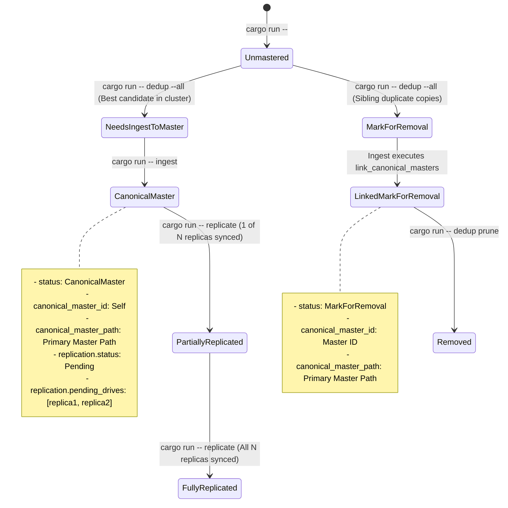

# Phase 1 Data Model: Master Asset Registration and Replication Lifecycle Tracking

## Entity Specifications

### 1. `ReplicationStatus` (Domain Enum)

Represents the overall backup synchronization state of a canonical master asset across configured replica drives.

| Value | Description |
|-------|-------------|
| `Pending` | Asset has not been synchronized to any configured replica drive yet |
| `PartiallyReplicated` | Asset has been synchronized to at least one replica drive, but at least one configured replica drive is still pending |
| `Replicated` | Asset has been verified and synchronized to all configured replica drives (or zero replica drives are configured) |

```rust
#[derive(Debug, Clone, Copy, PartialEq, Eq, Hash, Serialize, Deserialize)]
pub enum ReplicationStatus {
    Pending,
    PartiallyReplicated,
    Replicated,
}
```

---

### 2. `MasterReplicationState` (Domain Value Object)

Tracks the detailed replication history and drive-level completion for a `CanonicalMaster` document.

| Field | Type | Description |
|-------|------|-------------|
| `status` | `ReplicationStatus` | Overall replication state (`Pending`, `PartiallyReplicated`, `Replicated`) |
| `pending_drives` | `Vec<String>` | Drive IDs of configured replica targets awaiting this asset |
| `replicated_drives` | `Vec<String>` | Drive IDs of replica targets that have successfully received and verified this asset |
| `last_synced_at` | `Option<DateTime<Utc>>` | Timestamp of the most recent successful replica synchronization |

```rust
#[derive(Debug, Clone, PartialEq, Eq, Serialize, Deserialize)]
pub struct MasterReplicationState {
    pub status: ReplicationStatus,
    #[serde(default, skip_serializing_if = "Vec::is_empty")]
    pub pending_drives: Vec<String>,
    #[serde(default, skip_serializing_if = "Vec::is_empty")]
    pub replicated_drives: Vec<String>,
    #[serde(default, skip_serializing_if = "Option::is_none")]
    pub last_synced_at: Option<DateTime<Utc>>,
}
```

---

### 3. `DeduplicationMetadata` (Enhanced Domain Entity)

Embedded in `MediaMetadataDocument` stored in the MongoDB collection `media_assets`.

| Field | Type | Nullable | Description |
|-------|------|----------|-------------|
| `cluster_id` | `Uuid` | No | Identifier of the content cluster sharing this cryptographic hash |
| `status` | `DeduplicationStatus` | No | Lifecycle status (`CanonicalMaster`, `MarkForRemoval`, `ReplicaKeep`, `NeedsIngestToMaster`, `Removed`) |
| `canonical_master_id` | `Option<Uuid>` | Yes | Document ID of the authoritative canonical master document |
| `canonical_master_path` | `Option<PathBuf>` | Yes | Absolute filesystem path of the canonical master file on the primary drive |
| `drive_id` | `Option<String>` | Yes | Identifier of the drive containing this file instance |
| `drive_group` | `Option<String>` | Yes | Drive group (`primary`, `staging`, `replica1`, etc.) |
| `is_in_master_path` | `bool` | No | True if path strictly adheres to `<Year>/<DD-Mon-YYYY>/{Videos,Photos,PhotosRaw}` |
| `reclaimable_bytes` | `u64` | No | File size in bytes if marked for removal; 0 if canonical master or replica keep |
| `evaluated_at` | `DateTime<Utc>` | No | Timestamp of deduplication evaluation |
| `replication` | `Option<MasterReplicationState>` | Yes | Replication lifecycle status (populated for `CanonicalMaster` records) |

---

## State Transition Diagram


