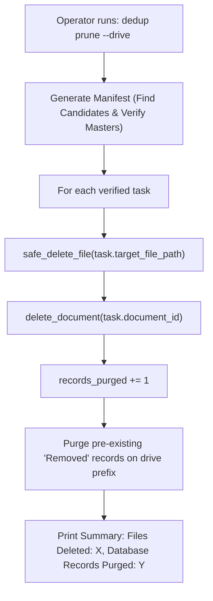

# Phase 1 Data Model: Purge Obsolete Database Records on Duplicate Prune

## Entities & Interfaces

### 1. `MetadataStorageSink` Trait Extension

Located in `src/domain/ports.rs`:

```rust
#[async_trait::async_trait]
pub trait MetadataStorageSink: Send + Sync {
    // ... existing methods ...

    /// Permanently deletes a single document by its UUID.
    /// Returns true if a document was matched and deleted.
    async fn delete_document(&self, doc_id: uuid::Uuid) -> Result<bool, StorageError>;

    /// Permanently deletes multiple documents by their UUIDs in a single batch.
    /// Returns the number of documents deleted.
    async fn delete_documents(&self, doc_ids: &[uuid::Uuid]) -> Result<usize, StorageError>;

    /// Purges all documents on a specific drive mount path prefix that are marked with status `Removed`.
    /// Returns the number of purged documents.
    async fn purge_removed_records(&self, mount_prefix: Option<&str>) -> Result<usize, StorageError>;
}
```

---

### 2. `PruneExecutionReport` Model Update

Located in `src/application/drive_pruner.rs`:

```rust
#[derive(Debug, Clone, PartialEq, Eq, Serialize, Deserialize)]
pub struct PruneExecutionReport {
    pub drive_id: String,
    pub mount_path: PathBuf,
    pub is_dry_run: bool,
    pub total_candidates: usize,
    pub verified_masters: usize,
    pub unverified_masters: usize,
    pub files_deleted: usize,
    pub records_purged: usize,       // NEW: Count of obsolete records deleted from database
    pub bytes_reclaimed: u64,
    pub errors: Vec<String>,
}
```

---

### 3. Execution Flow


