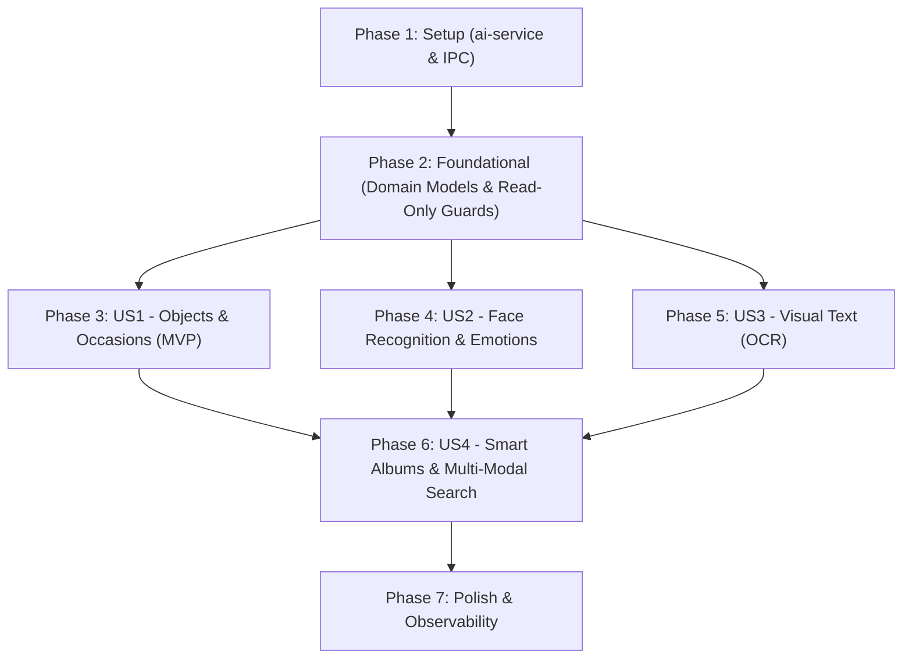

# Tasks: Visual Semantic Recognition, Face Search & Smart Albums

**Input**: Design documents from `specs/025-visual-semantic-recognition/` (`plan.md`, `spec.md`, `data-model.md`, `research.md`, `contracts/cli-contract.md`, `quickstart.md`)

**Prerequisites**:
- Rust 1.75+ toolchain (`cargo`)
- Python 3.10+ virtual environment for `ai-service`
- Local MongoDB running on `localhost:27017`

**Organization**: Tasks are grouped by user story to enable independent implementation, testing, and delivery of each capability.

---

## Format: `[ID] [P?] [Story] Description`

- **[P]**: Parallelizable task (independent files, no cross-dependencies)
- **[Story]**: Target user story label (`[US1]`, `[US2]`, `[US3]`, `[US4]`)
- Every task includes an explicit, concrete file path

---

## Phase 1: Setup (Shared Infrastructure)

**Purpose**: Initialize the Python AI sidecar service and shared IPC communication foundations.

- [X] T001 Create `ai-service/` package directory layout (`ai-service/pipelines/`, `ai-service/models/`) and define Python dependencies in `ai-service/requirements.txt` (`fastapi`, `uvicorn`, `ultralytics`, `insightface`, `onnxruntime`, `pillow`)
- [X] T002 [P] Implement lightweight FastAPI application skeleton with health check endpoint in `ai-service/service.py`
- [X] T003 [P] Add IPC client dependencies (`reqwest`, `serde_json`) to `Cargo.toml`
- [X] T004 Implement sidecar process manager and HTTP IPC client in `src/infrastructure/ai_client.rs` to automatically spawn, healthcheck, and communicate with `ai-service` over `http://127.0.0.1:8765`

---

## Phase 2: Foundational (Blocking Prerequisites)

**Purpose**: Core domain types, database schemas, and strictly read-only access guards required by all user stories.

**⚠️ CRITICAL**: Must be completed before implementing any user story.

- [X] T005 [P] Define `VisualSemanticMetadata`, `DetectedObject`, `DetectedOccasion`, `DetectedFace`, and `ExtractedTextSnippet` domain models with serde serialization in `src/domain/visual_models.rs`
- [X] T006 [P] Extend `MediaMetadataDocument` in `src/domain/metadata_models.rs` with `pub visual: Option<VisualSemanticMetadata>`
- [X] T007 Define `VisualInferencePort` asynchronous trait for model orchestration in `src/domain/ports.rs`
- [X] T008 [P] Implement strictly read-only file access guard in `src/infrastructure/vision_adapter.rs` ensuring canonical master files are never opened with write permissions, upholding the non-destructive invariant (FR-014)
- [X] T009 Implement MongoDB index definitions for `visual.objects.label`, `visual.faces.person_id`, and text search tokens in `src/infrastructure/mongodb_sink.rs`
- [X] T010 Extend `MetadataStorageSink` trait with `update_visual_metadata_batch` in `src/domain/ports.rs` and implement in `src/infrastructure/mongodb_sink.rs`

**Checkpoint**: Core domain and storage foundation ready — user story implementation can begin.

---

## Phase 3: User Story 1 - Object & Occasion/Scene Detection (Priority: P1) 🎯 MVP

**Goal**: Automatically detect physical objects (teddy bears, bikes, phones, flowers) and scene occasions (birthday, Christmas, gatherings) from photos, storing tags in MongoDB without modifying original files.

**Independent Test**: Run `metadata-extractor enrich --source <DIR> --enable-objects` on test images and verify `metadata-extractor search --object "bicycle"` and `metadata-extractor search --occasion "birthday"` return matching assets.

### Implementation for User Story 1

- [X] T011 [P] [US1] Implement YOLOv8 object detection and MobileCLIP scene classification pipeline in `ai-service/pipelines/object_scene.py`
- [X] T012 [P] [US1] Add `/v1/enrich/objects-scenes` batch endpoint to `ai-service/service.py` accepting file path arrays and returning detected labels with confidence scores (constrained to `0.0 ..= 1.0`)
- [X] T013 [US1] Implement `ObjectSceneService` in `src/application/visual_service.rs` to dispatch image paths to the AI client and accumulate `DetectedObject` and `DetectedOccasion` facets
- [X] T014 [US1] Add CLI argument parsing for `enrich --enable-objects` and `search --object <OBJ>` / `search --occasion <TAG>` in `src/main.rs` per `contracts/cli-contract.md`
- [X] T015 [US1] Implement search query evaluation for objects and occasions in `src/application/search_service.rs`
- [X] T016 [P] [US1] Add integration test in `tests/test_visual_enrichment.rs` verifying that object and occasion extraction executes in read-only mode and that BLAKE3 file hashes remain identical before and after extraction (SC-006)

**Checkpoint**: User Story 1 is functional and testable independently as an MVP.

---

## Phase 4: User Story 2 - Face Detection, Expression Analysis & Person Clustering (Priority: P2)

**Goal**: Detect localized faces, classify emotional expressions (smile, happy, sad, crying), compute 512-d face embeddings, cluster recurring identities into `PersonCluster`, and allow user-assigned naming.

**Independent Test**: Process multi-person photos with `enrich --enable-faces`, list clusters with `faces list`, assign a name via `faces name --cluster-id <ID> --name "Maya"`, and search via `search --person "Maya" --expression "smile"`.

### Implementation for User Story 2

- [X] T017 [P] [US2] Implement face detection, facial emotion classification, and 512-d ArcFace embedding extraction in `ai-service/pipelines/face_engine.py`
- [X] T018 [P] [US2] Add `/v1/enrich/faces` endpoint to `ai-service/service.py` returning bounding boxes `[x_min, y_min, x_max, y_max]`, expression scores, and 512-float vector embeddings
- [X] T019 [P] [US2] Define `PersonCluster` entity and agglomerative cosine-distance clustering logic (threshold cosine distance `<= 0.38`) in `src/domain/person_cluster.rs`
- [X] T020 [US2] Implement `PersonCluster` persistence and query methods (`save_person_cluster`, `list_person_clusters`, `update_person_name`, `merge_clusters`) in `src/infrastructure/mongodb_sink.rs`
- [X] T021 [US2] Implement `FaceManagementService` in `src/application/face_service.rs` orchestrating face cluster discovery, naming, and merging
- [X] T022 [US2] Add CLI commands `faces list`, `faces name`, `faces merge`, and search filters `--person <NAME>`, `--expression <EMOTION>` in `src/main.rs`
- [X] T023 [P] [US2] Add integration test in `tests/test_face_clustering.rs` verifying face detection, expression assignment, and cluster identity merging

**Checkpoint**: User Stories 1 and 2 work independently and in combination.

---

## Phase 5: User Story 3 - Visual Text (OCR) & In-Image Word Search (Priority: P3)

**Goal**: Extract readable text from photos (banners, signs, t-shirts, documents) and index extracted words for instant text-in-image searching.

**Independent Test**: Process images containing visible text (e.g. party banner "Happy 5th Birthday Liam"), query `search --text "Liam"`, and verify matching assets are returned.

### Implementation for User Story 3

- [X] T024 [P] [US3] Implement text detection and recognition pipeline in `ai-service/pipelines/ocr_engine.py` using Apple Vision framework OCR (macOS native) or EasyOCR fallback
- [X] T025 [P] [US3] Add `/v1/enrich/ocr` endpoint to `ai-service/service.py` returning recognized text snippets, normalized token arrays, and confidence scores
- [X] T026 [US3] Implement text normalization and token aggregation in `src/application/visual_service.rs` populating `search_tokens` and `text_snippets`
- [X] T027 [US3] Add CLI option `enrich --enable-ocr` and search flag `search --text <WORD>` in `src/main.rs`
- [X] T028 [P] [US3] Add integration test in `tests/test_ocr_text_search.rs` verifying OCR extraction and full-text word search

**Checkpoint**: User Stories 1, 2, and 3 are functional.

---

## Phase 6: User Story 4 - Smart Album Synthesis & Multi-Modal Search (Priority: P4)

**Goal**: Automatically synthesize named virtual smart albums (e.g. "2024 - Maya's Birthday Party") by combining dates, occasions, detected people, and objects without duplicating physical files on disk.

**Independent Test**: Run `albums generate --year 2024`, inspect generated smart albums with `albums list`, and verify zero bytes of new media files are written to master drives.

### Implementation for User Story 4

- [X] T029 [P] [US4] Define `SmartAlbum` and `SmartAlbumCriteria` entities with cover asset selection based on `MediaQualityRank` in `src/domain/smart_album.rs`
- [X] T030 [P] [US4] Implement `SmartAlbum` storage methods (`save_smart_album`, `list_smart_albums`, `get_smart_album_by_id`) in `src/infrastructure/mongodb_sink.rs`
- [X] T031 [US4] Implement `SmartAlbumSynthesisService` in `src/application/album_service.rs` clustering photos by temporal proximity, occasion tags, and recognized person IDs to generate descriptive album titles
- [X] T032 [US4] Implement multi-modal search combining person, emotion, object, text, and calendar queries in `src/application/search_service.rs`
- [X] T033 [US4] Add CLI subcommands `albums generate`, `albums list`, `albums export` in `src/main.rs` per `contracts/cli-contract.md`
- [X] T034 [P] [US4] Add integration test in `tests/test_smart_albums.rs` verifying virtual album synthesis, cover photo selection, and the single-copy disk invariant (zero duplicate master files)

**Checkpoint**: All 4 user stories are fully implemented and integrated.

---

## Phase 7: Polish & Cross-Cutting Concerns

**Purpose**: Performance optimization, telemetry, and end-to-end scenario validation.

- [X] T035 [P] Add real-time `indicatif` progress bars for batch visual enrichment displaying items/sec and elapsed time in `src/application/visual_service.rs` per Constitution Principle III
- [X] T036 Implement fallback handling and structured diagnostic logging for corrupt, unreadable, or truncated image formats in `src/infrastructure/vision_adapter.rs` per Constitution Principle V
- [X] T037 [P] Update documentation and user guide in `README.md` with visual enrichment, face management, and smart album commands
- [X] T038 Execute full end-to-end validation scenarios following `specs/025-visual-semantic-recognition/quickstart.md`

---

## Dependencies & Execution Order

### Phase Dependencies

### User Story Dependencies
- **User Story 1 (P1)**: Independent of US2, US3, US4. Can be deployed as MVP.
- **User Story 2 (P2)**: Independent of US1 and US3. Can be developed in parallel with US1.
- **User Story 3 (P3)**: Independent of US1 and US2. Can be developed in parallel.
- **User Story 4 (P4)**: Synthesizes features from US1, US2, and US3 to produce rich, named smart albums.

### Parallel Opportunities per Phase
- **Phase 1**: T002, T003 can run in parallel.
- **Phase 2**: T005, T006, T008 can run in parallel.
- **Phase 3**: T011, T012 can run in parallel with Rust CLI setup.
- **Phase 4**: T017, T018, T019 can run in parallel.
- **Phase 5**: T024, T025 can run in parallel.
- **Phase 6**: T029, T030 can run in parallel.
- **Phase 7**: T035, T037 can run in parallel.

---

## Implementation Strategy: MVP First

1. **Sprint 1 (MVP)**: Phase 1 (Setup) + Phase 2 (Foundational) + Phase 3 (US1: Object & Occasion Detection).
   - *Result*: Users can immediately enrich their library with teddy bears, bikes, TVs, phones, flowers, and party/holiday tags, and search by object/occasion.
2. **Sprint 2**: Phase 4 (US2: Face Recognition & Expression Clustering).
   - *Result*: Users can name family members and find smiling/happy portraits.
3. **Sprint 3**: Phase 5 (US3: In-Image OCR Text Extraction).
   - *Result*: Users can search for text on signs, banners, and shirts.
4. **Sprint 4**: Phase 6 (US4: Smart Albums) + Phase 7 (Polish).
   - *Result*: Automated virtual album creation and unified multi-modal search.
